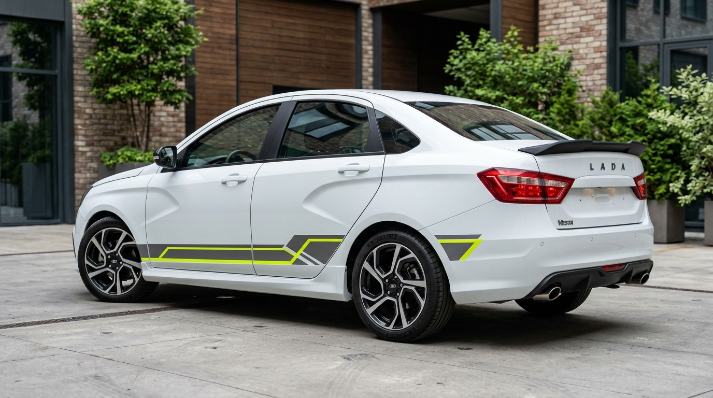
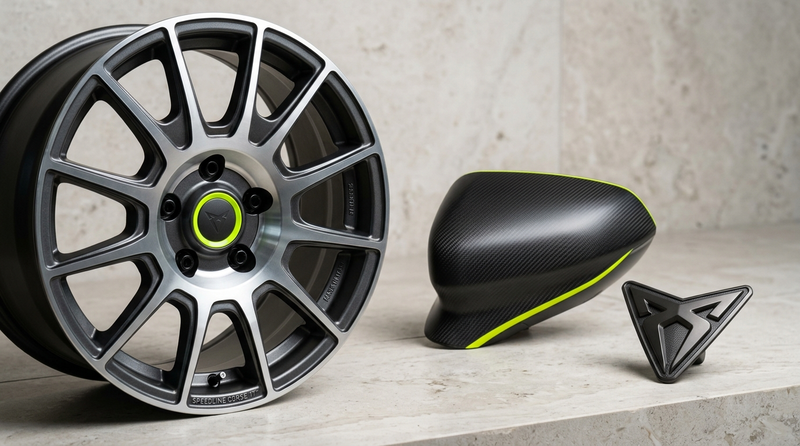
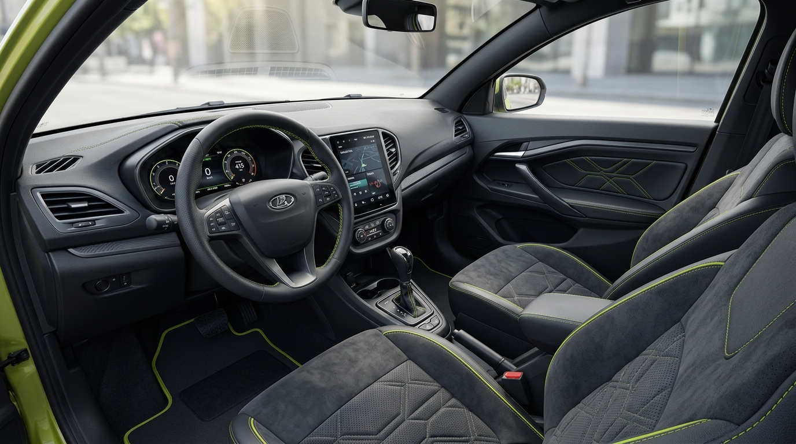
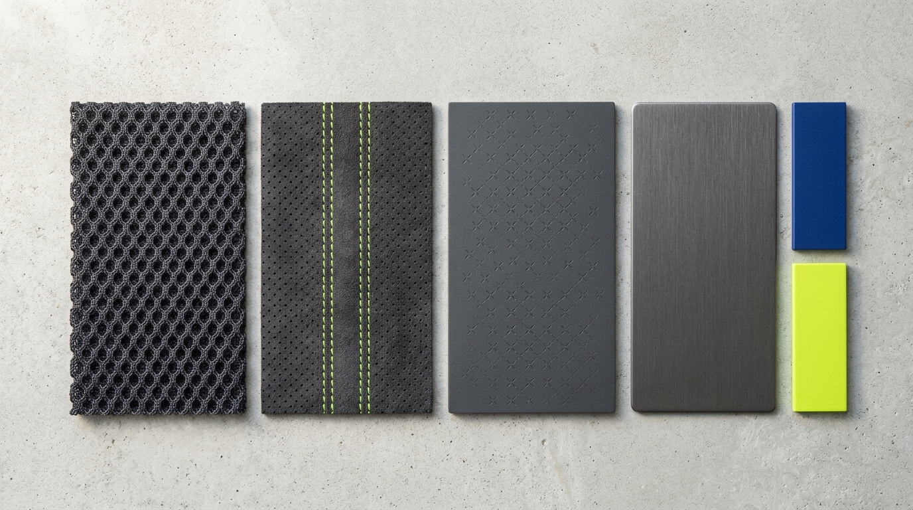
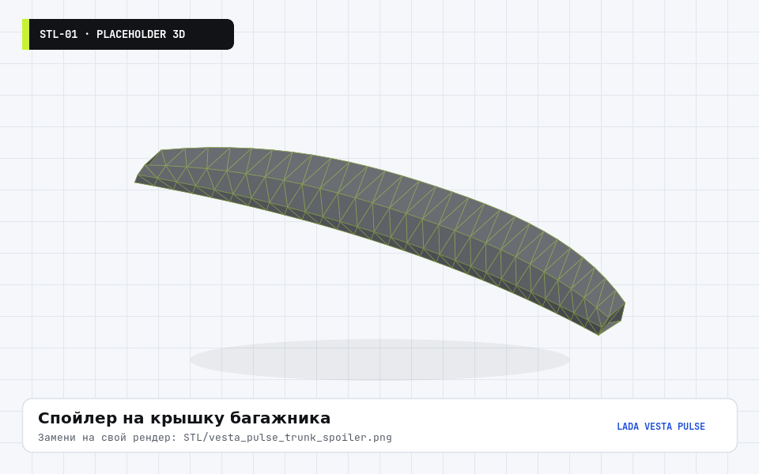
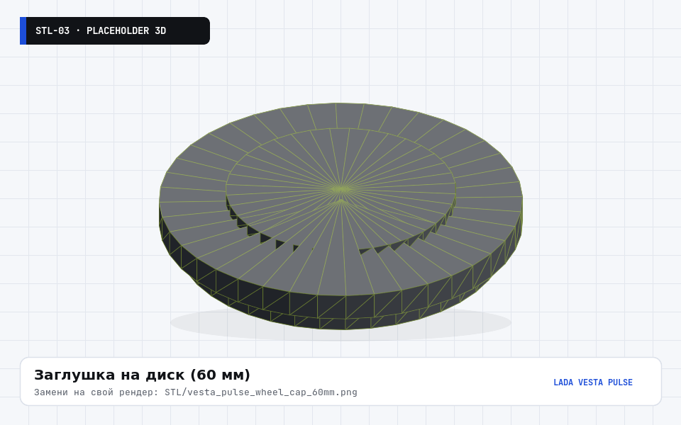
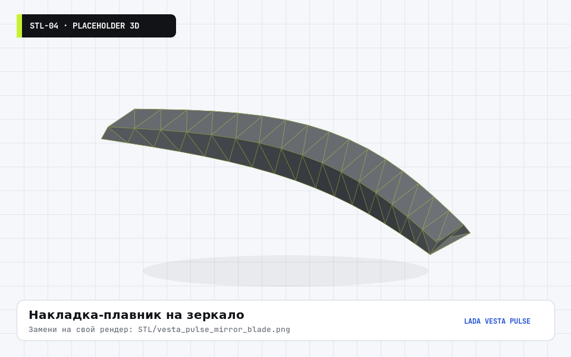
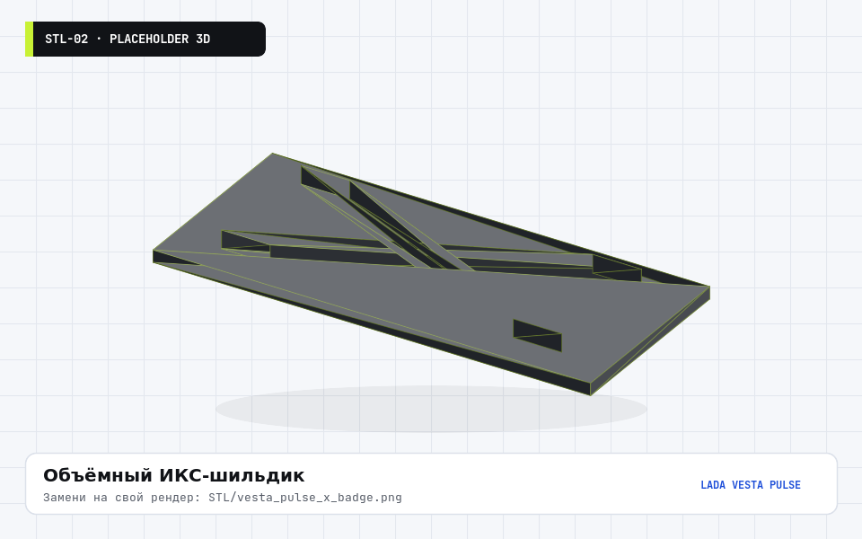
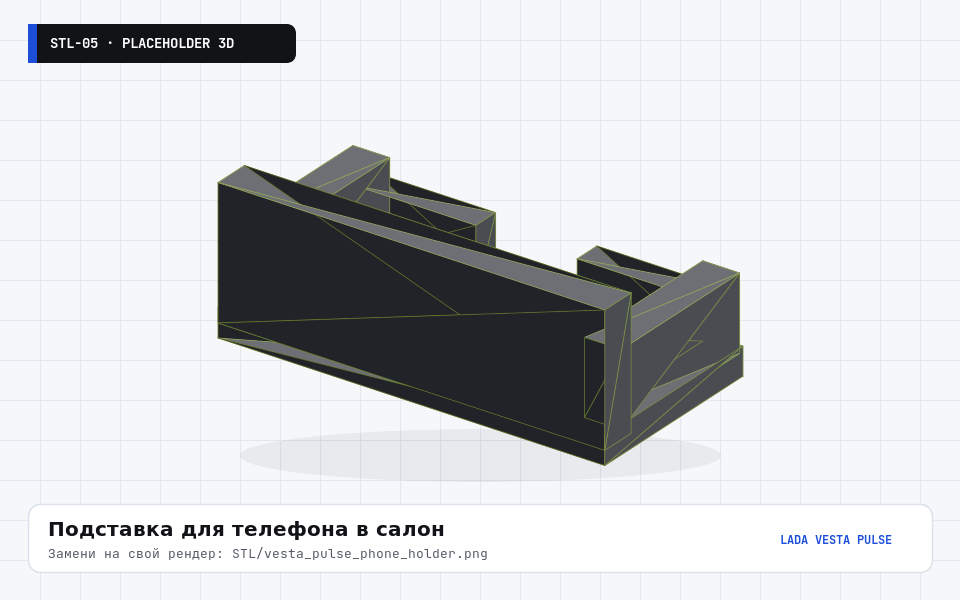
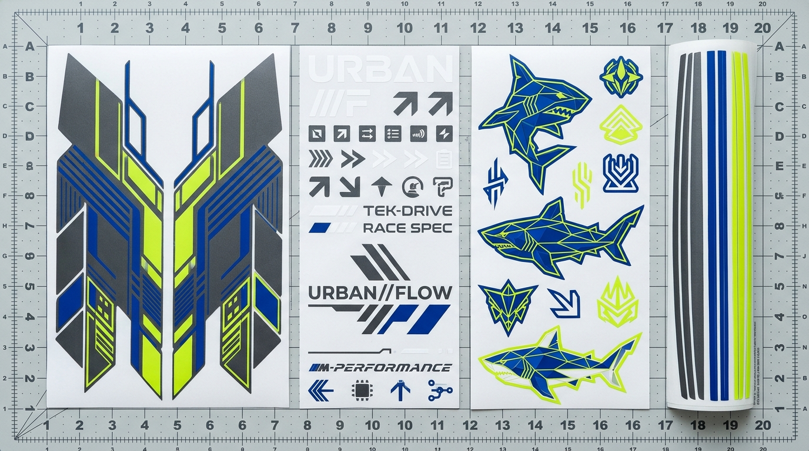

# 🚗 LADA Vesta Pulse
### Мой проект тюнинга Лады Весты · Инженеры транспорта

**LADA Vesta Pulse** — мой проект оформления автомобиля **LADA Vesta NG Седан** для конкурса «Инженеры транспорта». Я учусь в 8 классе, занимаюсь 3D-печатью и подумал: круто, если любой владелец Весты сможет зайти на сайт, бесплатно скачать готовые 3D-модельки (`.STL`) и наклейки (`.SVG`), распечатать всё на 3D-принтере и собрать стиль своими руками.

---

## 📸 Автомобиль

<p align="center">
  
  <br><sub>Главный вид LADA Vesta NG Седан с моими наклейками и 3D-деталями</sub>
</p>

| Фотография | Описание |
|---|---|
|  | **Вид спереди 3/4 (Белый)** |
|  | **Вид сзади — мой 3D-спойлер и наклейки** |
|  | **Проверка на 3 цветах: Белый, Серый, Синий** |
|  | **Диски 17", накладка зеркала и значок** |
|  | **Салон с чехлами и экран LADA EnjoY Pro** |
|  | **Материалы (пластик PETG, плёнка, ткань)** |

---

## 🧩 3D-модели и STL

Детали сделаны под размеры **LADA Vesta NG Седан**. Печатать лучше из **PETG**, потому что обычный PLA летом на солнце в машине может поплыть. Нажми **«Скачать STL»**, чтобы открыть файл в слайсере (Cura, PrusaSlicer, Bambu Studio).

### Детали для кузова

| Превью | Название | Как крепится | Файл |
|---|---|---|---|
|  | **Спойлер на багажник** | На скотч 3M (без сверления) | [⬇ Скачать STL](<STL/vesta_pulse_trunk_spoiler.stl>) |
|  | **Заглушка на диск (60 мм)** | Защёлкивается в центр диска | [⬇ Скачать STL](<STL/vesta_pulse_wheel_cap_60mm.stl>) |
|  | **Накладка-плавник на зеркало** | Клеится сверху на зеркало | [⬇ Скачать STL](<STL/vesta_pulse_mirror_blade.stl>) |

### Значки и в салон

| Превью | Название | Как крепится | Файл |
|---|---|---|---|
|  | **Объёмный ИКС-шильдик** | Двухцветная печать / 3M | [⬇ Скачать STL](<STL/vesta_pulse_x_badge.stl>) |
|  | **Подставка для телефона в салон** | Ставится в нишу без клея | [⬇ Скачать STL](<STL/vesta_pulse_phone_holder.stl>) |

---

## 🎨 Мои наклейки

<p align="center">
  
  <br><sub>Готовые листы наклеек для резки на плоттере</sub>
</p>

- **Наклейки «ИКС-Контур»** — полосы на двери и пороги ровно по линиям Лады Весты.
- **Стикерпак «Акула»** — перенёс наших угловатых акул из прошлого проекта **Smart Auto** на заднее крыло и стекло.
- **Полоски на диски и мелкие стикеры** — на обода колёс, лючок бензобака и панель в салоне.

---

## 📱 Сайт и презентация

На сайте проекта можно:
- посмотреть машину со всех сторон и попереключать цвета (**Белый**, **Серый**, **Синий**);
- скачать все **5 `.STL`-моделей** для 3D-принтера;
- скачать картинки (`.JPG`), схему наклеек (`.SVG` / `.PNG`) и тему для **LADA EnjoY Pro**;
- вписать своё ФИО, школу и скачать готовую презентацию на **10 слайдов в `.PPTX` (PowerPoint) или `.PDF`**.

### Как запустить сайт у себя на компьютере

```bash
npm install
npm run dev
```

---

## 📂 Структура проекта

```text
lada-vesta-pulse/
├── .github/workflows/
│   └── deploy.yml                # Автопубликация на GitHub Pages
├── STL/                          # .STL модели и их превью .png
│   ├── vesta_pulse_trunk_spoiler.stl
│   ├── vesta_pulse_trunk_spoiler.png
│   ├── vesta_pulse_x_badge.stl
│   ├── vesta_pulse_x_badge.png
│   ├── vesta_pulse_wheel_cap_60mm.stl
│   ├── vesta_pulse_wheel_cap_60mm.png
│   ├── vesta_pulse_mirror_blade.stl
│   ├── vesta_pulse_mirror_blade.png
│   ├── vesta_pulse_phone_holder.stl
│   └── vesta_pulse_phone_holder.png
├── src/
│   ├── assets/images/            # Картинки и рендеры
│   ├── components/               # Страницы сайта и 10 слайдов
│   ├── data/collectionData.ts
│   └── utils/                    # Генератор .STL и экспорт PDF/PNG
├── index.html
├── package.json
└── README.md
```

---

## 💡 О проекте

**LADA Vesta Pulse** — это школьный проект про то, как с помощью 3D-принтера и плоттера можно недорого и красиво прокачать обычную Ладу Весту.

**Направление:** Инженеры транспорта  
**Проект:** LADA Vesta Pulse 🚗
