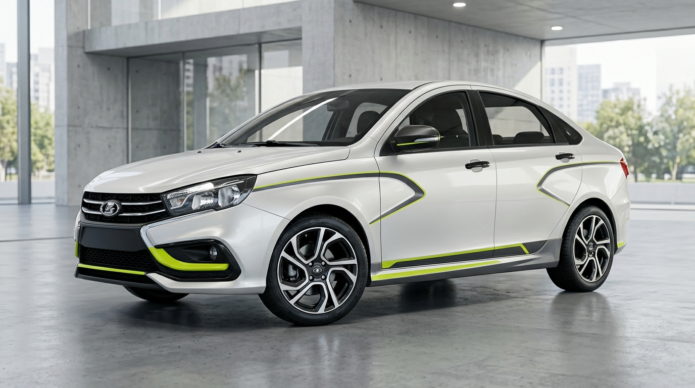
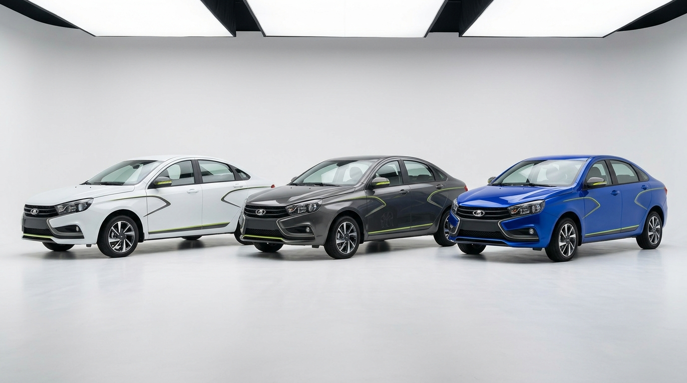
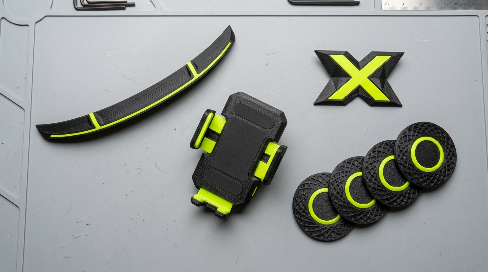

# 🚗 LADA Vesta Pulse
### Кастомизация для нового поколения · Инженеры транспорта

**LADA Vesta Pulse** — авторская капсульная коллекция кастомизации **LADA Vesta NG Седан** для конкурса «Инженеры транспорта» (Первые × АВТОВАЗ). В основе проекта — доступная 3D-печать съёмных деталей и кастомные виниловые наклейки, модели и макеты которых можно бесплатно скачать на официальном сайте проекта.

---

## 📸 Автомобиль

<p align="center">
  
  <br><sub>Главный вид LADA Vesta NG Седан с авторскими наклейками и 3D-деталями</sub>
</p>

| Фотография | Описание |
|---|---|
|  | **Вид спереди 3/4 (Белый «Ледниковый»)** |
|  | **Вид сзади — 3D-спойлер и боковые стикеры** |
|  | **Адаптация на 3 цветах кузова (Белый, Тайфун, Кобальт)** |
|  | **Диски 17", накладка зеркала и шильдик** |
|  | **Интерьер автомобиля и LADA EnjoY Pro** |
|  | **Карта материалов CMF (пластик, винил, ткани)** |

---

## 🧩 3D-модели и STL

Каждая деталь разработана под штатные места **LADA Vesta NG Седан** и печатается из термостойкого пластика **PETG / ASA**. Нажми **«Скачать STL»**, чтобы получить файл для 3D-печати.

### Декоративные элементы экстерьера

| Превью | Название | Крепление | Файл |
|---|---|---|---|
|  | **Лип-спойлер крышки багажника** | Скотч 3M VHB | [⬇ Скачать STL](<STL/vesta_pulse_trunk_spoiler.stl>) |
|  | **Заглушка ступицы диска (Ø 60 мм)** | Защёлка в штатный диск | [⬇ Скачать STL](<STL/vesta_pulse_wheel_cap_60mm.stl>) |
|  | **Декоративный плавник зеркала** | На штатный корпус | [⬇ Скачать STL](<STL/vesta_pulse_mirror_blade.stl>) |

### Логотипы и аксессуары салона

| Превью | Название | Крепление | Файл |
|---|---|---|---|
|  | **Объёмный ИКС-шильдик** | Двухцветный PETG / 3M | [⬇ Скачать STL](<STL/vesta_pulse_x_badge.stl>) |
|  | **Держатель смартфона на панель** | Клипса без клея | [⬇ Скачать STL](<STL/vesta_pulse_phone_holder.stl>) |

---

## 🎨 Авторские наклейки

<p align="center">
  
  <br><sub>Готовые листы виниловых наклеек для плоттерной резки</sub>
</p>

| Коллекция | Описание | Зоны нанесения |
|---|---|---|
| **Пакет «ИКС-Контур»** | Двухслойные полосы (Графит + Вольт-Лайм), повторяющие выштамповки кузова | Борта дверей, пороги, передний бампер |
| **Коллекция «Акула»** | Полигональные стикеры в развитии линейки Smart Auto | Задние стойки, крыло, крышка багажника |
| **Полосы на диски и техно-иконки** | Дуги на обода 16"/17" и мелкие акценты для гаджетов и салона | Обода колёсных дисков, лючок, торпедо |

---

## 📱 Официальный сайт и презентация проекта

На сайте проекта (создан на React + Vite) доступны:
- **Каталог 3D-печати (`.STL`)** — параметры печати (пластик, заполнение, время) и прямое скачивание 3D-моделей.
- **Библиотека наклеек и UI** — скачивание всех рендеров (`.JPG`), векторной развёртки наклеек под плоттер (`.SVG` / `.PNG`) и макетов темы **LADA EnjoY Pro** и цифровой приборной панели.
- **Презентация из 10 слайдов (16:9)** — редактируемый титульный лист и выгрузка готовой презентации в **`.PDF`** или отдельных слайдов в **`.PNG`**.

### Запуск сайта локально

```bash
npm install
npm run dev
```

Для сборки и публикации на **GitHub Pages** достаточно запушить код в ветку `main` и включить **Settings → Pages → Source: GitHub Actions**.

---

## 📂 Структура проекта

```text
lada-vesta-pulse/
├── .github/workflows/
│   └── deploy.yml                # Автосборка сайта на GitHub Pages
├── STL/
│   ├── vesta_pulse_trunk_spoiler.stl
│   ├── vesta_pulse_x_badge.stl
│   ├── vesta_pulse_wheel_cap_60mm.stl
│   ├── vesta_pulse_mirror_blade.stl
│   └── vesta_pulse_phone_holder.stl
├── src/
│   ├── assets/images/            # Фото и рендеры LADA Vesta NG
│   ├── components/               # Разделы сайта и 10 слайдов презентации
│   ├── data/collectionData.ts
│   └── utils/                    # Генератор .STL и экспорт PDF/PNG
├── index.html
├── package.json
└── README.md
```

---

## 💡 О проекте

**LADA Vesta Pulse** — это объединение 3D-печати, виниловой графики и цифрового интерфейса автомобиля.

От 3D-модели на официальном сайте до готовой детали из PETG, от плоттерной резки наклеек до скина LADA EnjoY Pro — каждый владелец может кастомизировать серийную LADA Vesta NG своими руками без сверления и перекраски кузова.

**Направление:** Инженеры транспорта  
**Проект:** LADA Vesta Pulse 🚗
